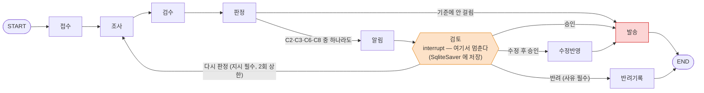
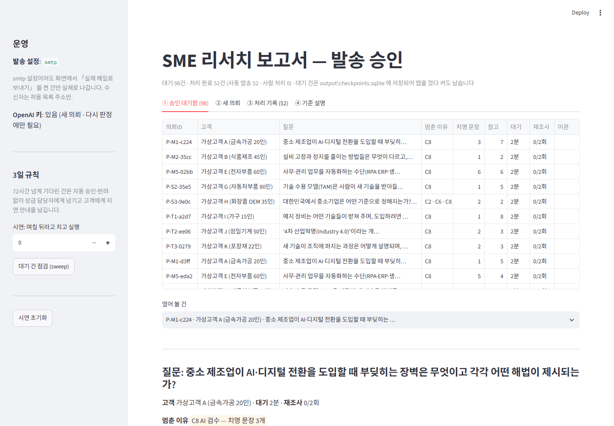
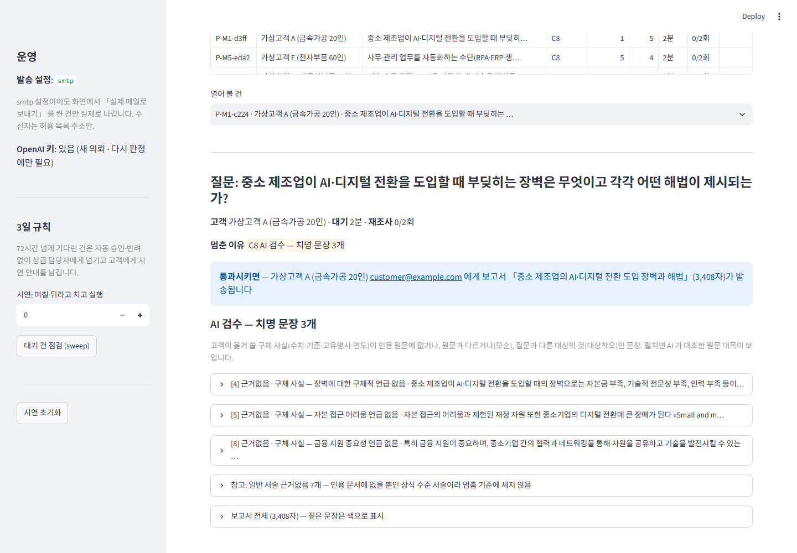
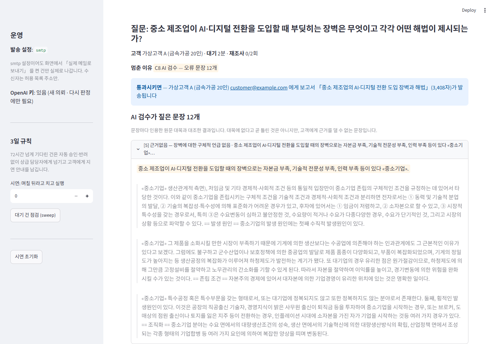
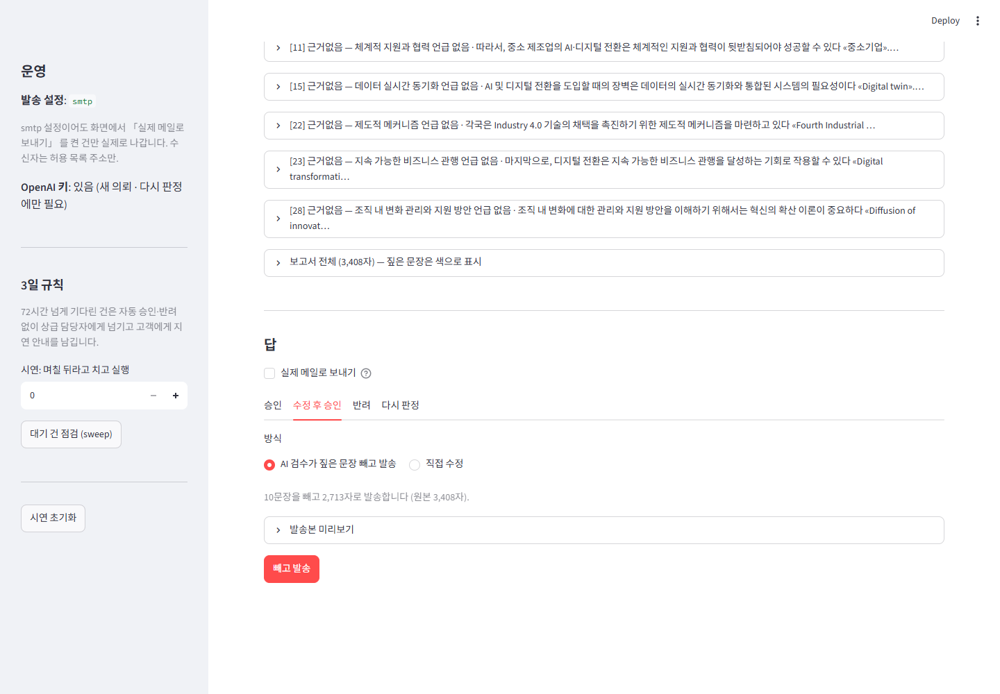

# REPORT — SME 리서치 보고서, 고객에게 보내기 전에 사람이 승인한다

모두의연구소(AIFFEL) Main Quest 05 「사람이 승인하는 에이전트 만들기」 · 2026-09-28

## 한눈에

| | |
|---|---|
| 자동화한 일 | 딥리서치 에이전트가 쓴 **SME AI·디지털 전환 조사 보고서를 고객(중소기업 대표)에게 발송** |
| 되돌릴 수 없는 순간 | 발송. 고객이 읽고 보고서의 수치·기준을 그대로 의사결정에 옮겨 쓴다 |
| 멈추는 자리 | 발송 바로 앞 (`검토` 단계의 `interrupt`) |
| 멈춤 기준 | C2 인용 원문에 없는 숫자 · C3 지표 경보 · C6 국내 질문에 해외 근거 · **C8 AI 검수 치명 문장 ≥ 1** |
| 검증 | 지난 실행 기록 297건 → 층화 표본 150건 · gpt-4o 문장 판정 2,893문장 · 사람 판정 30건 · 실제 운영 9건 |
| 결과 | 표본 150건 개입률 **65%** (자동 발송 52 · 대기 98). 처음 기준(v1)은 88% 였고, 운영해 본 담당자 피드백으로 고쳤다(v2) |
| 가장 큰 발견 | 개입률이 높은 원인은 기준이 아니라 **생성기**다. 판정한 고유 문장 2,801개 중 22.5% 가 인용 원문으로 뒷받침되지 않았다. 승인 기준만으로는 자동화율을 확보할 수 없고, 그래서 건당 검토 시간을 줄이는 쪽으로 화면을 설계했다 |
| 비용 | 약 4달러 (정답 라벨용 gpt-4o 판정 약 3.8달러 · 새 의뢰·다시 판정 실제 실행 5회 약 0.18달러) |

---

## 1. 주제와 고른 이유

### 무엇을 자동화했나

만든 사람의 본업은 중소기업 대표에게 AI·디지털 전환을 조언하는 「SME AI 주치의」 다. 지난 퀘스트에서 만든 딥리서치 에이전트([sme-deep-research](https://github.com/inseoklee-ai/sme-deep-research))는 질문 하나를 받으면 목차를 짜고 조사관 여럿이 위키백과 45건을 나눠 읽어 인용이 달린 보고서를 쓴다. 이번에는 그 보고서를 **고객에게 보내는 단계**까지 자동화하고, 그 앞에 사람의 승인을 붙였다.

```
의뢰 → [조사 · 집필 — 몇 번을 다시 해도 괜찮다] → [검수 · 판정] → ║ 발송 — 되돌릴 수 없다 ║
```

- 조사와 집필은 틀려도 다시 돌리면 된다.
- **발송은 되돌릴 수 없다.** 고객은 보고서의 「세계 수준 OEE 85%」, 「한국 중소기업 기준 300명」 같은 수치를 그대로 자기 회사 계획에 옮겨 쓴다. 틀린 수치가 한 번 나가면 컨설턴트의 신뢰가 무너진다.

### 왜 이 주제인가

| 관점 | 이유 |
|---|---|
| 과제 충실성 | 가장 어려운 요구는 "멈춤 기준을 정하고 **왜 맞는지** 설명하기" 다. 지난 퀘스트의 **실행 기록 297건**이 있어 기준을 API 비용 없이 여러 번 걸어 보고, 개입률 · 놓침 · 헛멈춤을 숫자로 비교할 수 있었다 |
| 도메인 | 본업 도메인이다. 「한국 기준을 물었는데 해외 자료로 답한다」 같은 도메인 특유의 위험(C6)을 기준에 넣을 수 있었다 |
| 재사용 | 딥리서처는 **한 줄도 고치지 않고** 가져와 `import` 했다. 기존 에이전트 뒤에 승인 단계를 붙이는 구조가 분명하다 |

후보였던 「정부지원사업 문의 자동 답변」 은 공고 데이터(기업마당 API)와 합성 문의를 새로 만들어야 해서 다음 프로젝트로 미뤘다.

---

## 2. 파이프라인 구조

### 구조도



| 노드 | 하는 일 | 바깥으로 나가는가 |
|---|---|---|
| 접수 | 의뢰 ID(= `thread_id`) · 고객 · 질문 · 접수시각 | 아니오 |
| 조사 | 새 의뢰는 딥리서치 실행(`graph.run`, gpt-4o-mini), 지난 기록은 297건 중 하나를 불러옴. 다시 판정이면 담당자 지시를 붙여 다시 조사 | 아니오 |
| 검수 | 문장마다 인용 문서의 관련 대목(임베딩 검색 3개)과 대조해 gpt-4o 가 판정 — 뒷받침 · 일반서술 · 근거없음 · 모순 · 대상착오 + 「구체 사실인가」. 실패하면 통과가 아니라 「확인 못 함」 | 아니오 |
| 판정 | `criteria.켜진기준` 계산 → 멈춘 이유 목록 | 아니오 |
| 알림 | 「검토 중입니다」 안내 기록, 대기 시작 시각 | 안내 (기록) |
| **검토** | **`interrupt` 만.** 화면에 보여 줄 내용을 담아 멈춘다 | 아니오 |
| 수정반영 | 치명 문장 빼기 또는 담당자 수정본 → 발송본 · 바뀐 줄 수 | 아니오 |
| 발송 | 파일(기본) 또는 SMTP. 실패·차단이면 끝난 것으로 치지 않고 직접 처리 목록 | **예** |
| 반려기록 | 사유와 함께 직접 처리 목록 | 아니오 |

### 상태 (State)

| 키 | 내용 | 쓰는 노드 |
|---|---|---|
| `의뢰` | id · 고객 · 수신자 · 질문 · 입구 · 접수시각 | 접수 |
| `보고서` | 제목 · 본문 · 지표 · 절 · **검수**(문장별 판정과 원문 대목) | 조사 · 검수 |
| `멈춘이유` | 걸린 기준 목록 (비면 자동 발송) | 판정 |
| `대기시작` | 3일 규칙 계산용 | 알림 |
| `답` | 결정 · 사유 · 지시 · 방식 · 수정본 · 담당자 · 시각 · 파일만 | 검토 (resume 값) |
| `재조사횟수` | 다시 판정 상한 2회 | 조사 |
| `수정` · `발송본` | 수정 방식 · 뺀 문장 · 바뀐 줄 | 수정반영 |
| `발송` · `결과` | 발송 기록 · 자동 발송 / 승인 발송 / 수정 발송 / 반려 / 발송 실패 | 발송 · 반려기록 |
| `이력` | 담당자 답 · 재조사 · 재발송 — 쌓이기만 한다 (`operator.add`) | 검토 · 조사 |

### 멈추고 이어가기 — 1단계에서 직접 확인한 것

가짜 보고서 3건으로 뼈대를 먼저 만들고, **명령마다 새 프로세스**로 돌려 확인했다 ([step1_output.txt](docs/evidence/step1_output.txt)).

- **체크포인터는 `SqliteSaver`** (`output/checkpoints.sqlite`). 프로그램을 완전히 끄고 새로 켜도 대기 건을 찾는다. `InMemorySaver` 였다면 사라졌다.
- **대기함은 따로 만들지 않았다.** 체크포인터의 모든 `thread_id` 중 `get_state().next` 가 비어 있지 않은 것이 곧 대기 건이고, 승인 화면에 보여 줄 내용은 `interrupt` 값으로 함께 저장된다.
- **재실행 함정을 재현했다.** `interrupt` 앞에 「검토 중입니다」 알림을 두면 재개할 때 알림이 **두 통** 나갔다. 그래서 원칙을 세웠다: **검토 단계 안에는 `interrupt` 만 둔다.** 조사(비싸다) · 검수(비싸다) · 알림 · 발송(바깥으로 나간다)은 모두 다른 단계다.
- **같은 `thread_id` 는 한 번만 발송**된다 (발송 기록 확인). 발송 단계가 어떤 이유로 다시 실행돼도 두 번 나가지 않는다.

---

## 3. 승인 기준과 그 이유

### 최종 기준 (v2)

| 기준 | 계산식 | 막으려는 위험 | 왜 이 기준인가 |
|---|---|---|---|
| **C2** 인용 원문에 없는 숫자 | 인용이 달린 문장의 숫자를 **단위까지 읽어 값으로** 바꿔(5000만 = 50 million), 인용 문서 원문 어디에도 같은 값이 없으면 | 틀린 수치가 출처를 달고 나가는 것 | 걸리면 거의 확실히 진짜 문제 (표본에서 헛멈춤 0). 코드라 비용 0 · 즉시 |
| **C3** 지표 경보 | 딥리서처 지표의 경보 7종(지어낸 제목 인용 · 읽지 않은 문서 인용 · 절 밖 인용 …) 중 하나라도 | 가짜 출처 | 위와 같다 |
| **C6** 국내 질문에 해외 근거 | 질문에 한국·국내가 있는데, 숫자가 든 문장이 해외(비한국어) 문서만 인용하고 다른 나라 이름도 없으면 | 해외 기준이 한국 기준처럼 읽히는 것 | 도메인에서 나온 기준. 실제로 「대한민국 기준 300명·500억」 을 영어 문서로 단 문장을 잡았다 |
| **C8** AI 검수 치명 문장 ≥ 1 | 모순 · 대상착오, 또는 **구체 사실**(수치·기준·고유명사·연도)의 근거없음이 한 문장이라도 | 고객이 옮겨 쓸 사실이 근거 없이 나가는 것 | 가장 흔한 오류(「인용한 문서가 그 말을 하지 않는 문장」)는 원문과 대조해 읽어야만 잡힌다. 구체 사실이 없는 일반 서술의 근거없음은 세지 않는다 (4장 v2) |

**놓침과 헛멈춤 중 무엇이 비싼가** — 놓침이다. 틀린 보고서가 고객에게 가면 되돌릴 수 없고 신뢰가 무너진다. 헛멈춤은 담당자의 검토 시간만 든다. 그래서 **구체 사실은 하나라도 근거가 없으면 멈춘다(≥ 1).** 다만 헛멈춤이 지나치면 담당자가 보지 않고 승인하게 되어 결국 놓침이 된다는 것을 7단계 운영에서 겪었다 — 그래서 v2 에서 「치명」 의 범위를 좁혔다.

### 뺀 후보

| 후보 | 뺀 이유 |
|---|---|
| C1 출처 없는 수치 | 표본에서 0건 (딥리서처가 거의 모든 수치에 인용을 단다) |
| C4 근거율 70% 미만 | 26% 가 걸린다. 근거율은 인용 **개수**라 인용이 틀린 것(가장 흔한 오류)을 못 본다 |
| C5 부족한 절 남음 | 「덜 자세함」 은 오류가 아니라고 정의했다 |
| C7 고위험 주제어 | 28% 가 걸린다. 「개인정보」 · 「투자」 가 일반 설명에 흔히 나온다 — 헛멈춤 제조기 |

### 자동으로 나가는 건 — 왜 사람이 안 봐도 되는가

C2 · C3 · C6 에 걸리지 않고, AI 검수에서 **구체 사실이 모두 인용 원문과 맞았으며**, 근거를 못 댄 것은 일반 서술뿐인 보고서다. 고객이 그 보고서에서 옮겨 적을 수치 · 기준 · 이름은 모두 원문에 있다.

> **예 — P-M3-5164** 「제품 품질을 관리하는 방식들은 어떻게 다르고 서로 어떻게 보완하는가?」 · 21문장: 뒷받침 15 · 일반서술 5 · 근거없음 1. 근거없음 한 문장은 「품질 관리는 조직, 제품 또는 서비스가 일관되게 의도한 대로 수행되도록 보장하는 시스템이다」 — 구체 사실이 없는 정의다. 치명 0 → **자동 발송.**

> **멈춘 예 — P-S3-9e0c** 「대한민국에서 중소기업은 어떤 기준으로 정해지는가?」 → C2 · C6 · C8 (치명 2)
> - 근거없음 · 구체 — 「일반적으로 중소기업은 직원 수가 300명 이하이거나 연매출이 500억 원 이하인 기업으로 분류된다 «Small and medium enterprises»」 (영어 문서에 한국 기준이 없다)
> - 대상착오 — 「중소기업은 한국 경제에서 … 전체 기업의 99% 이상을 차지하고 있다 «Small and medium enterprises»」 (다른 지역 통계를 한국 것처럼)

---

## 4. 기준을 정하고 검증한 과정

기준을 한 번에 정하지 않았다. 후보를 코드로 만들어 걸어 보고, 정답을 따로 만들어 비교하고, 운영해 보고 다시 고쳤다.

### 4-1. 후보 7개를 297건에 걸다 (3단계 · [step3_scan.md](docs/evidence/step3_scan.md))

걸어 보며 고친 것:

- **C2 단위 맞춤** — 글자 그대로 비교하니 「5000만 유로」 와 원문 「50 million euro」 를 다르다고 봤다(헛멈춤). 반대로 「300」 이 원문의 「300,000」 안에 있다고 통과시켰다(놓침). 숫자를 값으로 읽게 바꾸자 헛멈춤은 사라지고 놓침은 새로 잡혔다.
- **이름 속 숫자** — 「Industry 4.0」 · 「4차 산업혁명」 의 숫자는 수치가 아니다.
- **C6 계산식** — 처음 식(인용 문서 중 한국어 비율 < 50%)은 **한 번도 걸리지 않았다.** 국내 질문 27건이 모두 한·영 문서 1건씩(정확히 50%)이었다. 문장 단위로 바꾸자 실제 오류가 잡혔다.

### 4-2. 정답 라벨 — 기준과 독립으로 (4단계)

놓침을 재려면 「이 보고서는 사람이 봤어야 했다」 는 정답이 기준과 **따로** 있어야 한다.

- **정의**: 고객에게 그대로 나가면 안 되는 오류가 하나라도 있는 보고서 — 사실과 다른 수치·주장 / 인용 문서가 뒷받침하지 않음 / 질문과 다른 대상. 표현이 투박하거나 덜 자세한 것은 오류가 아니다.
- **AI 판정**: 297건에서 질문별 층화 표본 150건 → 문장 2,893개를 gpt-4o 가 인용 원문 대목과 대조해 판정 (약 3.8달러).
- **사람 판정**: 그중 30건(기준에 걸린 것 15 · 안 걸린 것 15, 어느 쪽인지 숨김)을 담당자가 판정지([label_app.py](label_app.py))로 판정. **담당자는 다른 AI 검토 도구의 문장별 검토표를 참고했다** — 이 판정은 「AI 보조 사람 판정」 이다.

사람 판정과 가장 잘 맞은 AI 정의는 「구체적 주장이 인용 문서에 없으면 오류」(엄격)였다 — 일치율 83.3%, 카파 0.21. 카파가 낮은 것은 둘 다 「거의 전부 멈춤」 이어서다.

결과는 예상과 달랐다. **표본의 95~97% 가 「사람이 봤어야 함」** 이었다 (AI 엄격 146/150, 사람 판정으로 덮어쓴 정답 143/150). 한 보고서에 문장이 20~40개 있고 그중 한둘은 거의 반드시 인용 원문으로 뒷받침되지 않았다. 코드 기준(C1~C7)을 전부 켜도 놓침이 64건이었다 — 숫자나 경보 같은 코드 신호로는 「인용한 문서가 그 말을 하지 않는 문장」 이 안 잡힌다. 그래서 **문장을 원문과 대조하는 AI 검수 노드와 C8 을 추가**했다.

C8 은 AI 판정과 같은 판정을 쓰므로, AI 라벨을 정답으로 재면 자기 자신과 비교하는 순환이 된다. **C8 은 사람 판정 30건으로만 쟀다** ([step4_validation.md](docs/evidence/step4_validation.md) 4절).

### 4-3. C8 v1 → v2

| 판 | C8 계산 | 표본 150건 개입률 | 4단계 사람 판정 기준 놓침 · 헛멈춤 | 7단계 그대로 승인한 8건 중 멈춤 |
|---|---|---:|---|---:|
| v1 (4단계) | 근거없음·모순·대상착오 전부 ≥ 4 | 86% | 2/25 · 3/5 | — |
| v1 (6단계 수정) | 〃 ≥ 3 | 88% | 3/25 · 3/5 | 8/8 |
| **v2 (7단계 뒤, 지금)** | **치명 문장 ≥ 1** | **65%** | 10/25 · 2/5 | 6/8 |

- **6단계 수정** — 승인 화면을 보다가 「변화 관리 _(현장적용 담당)_」 같은 **절 이름표 줄**이 문장으로 판정되고 있는 것을 찾았다. 이름표 125줄 중 44줄이 근거없음, 1줄이 판정실패로 C8 을 부풀렸고, 「빼고 발송」 이 절 제목까지 지웠다. 이름표를 빼고 다시 재니 ≥ 4 의 놓침이 2 → 4/25 로 늘어, 결정(놓침을 막는다)의 취지대로 ≥ 3 으로 낮췄다.
- **v2** — v1 으로 실제 운영(6장)해 보니 짚힌 오류 645문장 중 **486문장(75%)이 구체 사실 없는 일반 서술의 근거없음**이었다. 담당자는 그런 보고서를 9건 중 8건 그대로 승인했고, 이유를 「근거없음의 대부분이 상식 수준의 일반 서술이라 치명적이지 않다」 고 설명했다. 그래서 **고객이 옮겨 쓸 구체 사실 · 모순 · 대상착오만 센다.**

**두 번의 사람 판단이 달랐다.** 같은 담당자가 4단계 판정지(AI 검토표 참고 — 표현 문제까지 지적하는 엄격한 기준)에서는 「봤어야 함」 이라 한 보고서 2건을, 7단계 운영(본인의 상식 판단)에서는 그대로 승인했다. v2 는 운영 쪽을 따랐고, 대가로 4단계의 엄격한 판정 기준으로는 놓침이 3 → 10/25 로 늘었다. 어느 쪽이 「진짜 정답」 인지는 30건으로 가릴 수 없다 — 이 한계를 8장에 적었다.

---

## 5. 네 가지 응답과 운영 규칙

| 응답 | 뒤에 일어나는 일 |
|---|---|
| 승인 | 원본 그대로 발송 |
| 수정 후 승인 | ① **치명 문장 빼고 발송** (버튼 하나 — 일반 서술은 남긴다) ② 직접 수정. 뺀 문장 수 · 바뀐 줄 수 · 원본/발송본 글자 수를 기록 |
| 반려 | **사유 필수.** 발송하지 않고 「담당자 직접 처리」 목록으로. 사유는 기준을 고칠 재료 |
| 다시 판정 | **지시 필수.** 지시를 붙여 실제로 다시 조사 → 검수 → 판정. 다시 걸리면 대기함으로. **2회 상한** — 넘으면 승인·수정·반려만. 다시 조사에 실패하면 이전 보고서로 다시 사람에게 |

- 규칙에 어긋난 답(사유 없는 반려, 지시 없는 다시 판정, 상한 초과, 이미 끝난 건)은 그래프에 넣지 않고 거절한다 ([step5_output.txt](docs/evidence/step5_output.txt)).
- **3일 규칙** — 72시간 넘게 처리되지 않은 대기 건은 **자동 승인도 자동 반려도 하지 않는다.** 자동 승인은 놓침을 막는다는 결정과 어긋나고, 자동 반려는 고객 요청을 조용히 없앤다. 대신 상급 담당자에게 넘기고(이관 기록) 고객에게 지연 안내를 남긴다. 한 건에 한 번만.
- **발송 안전장치** — 기본은 파일. 실제 메일은 `SEND_MODE=smtp` + 수신자 허용 목록 + 화면의 「실제 메일로 보내기」 체크(기본 꺼짐) + 공개 모드 아님 을 모두 갖춰야 나간다. 같은 의뢰는 한 번만. 시험 · 기준 검증 · 지난 기록 입구는 항상 파일 ([tests/test_mailer.py](tests/test_mailer.py)).
- **발송 실패는 끝난 게 아니다** — 7단계에서 SMTP 인증 실패인데 결과가 「자동 발송」 으로 끝나는 버그를 찾았다. 나가지 않은 보고서를 보냈다고 착각할 수 있다. 실패·차단은 「발송 실패」 로 남겨 직접 처리 목록에 올리고 재발송할 수 있게 고쳤다 ([tests/test_resend.py](tests/test_resend.py)).

---

## 6. 실행 결과 ([step7_results.md](docs/evidence/step7_results.md))

### 6-1. v1 기준으로 운영 (7단계)

| 입구 | 건수 | 자동 발송 | 멈춤 |
|---|---:|---:|---:|
| 지난 기록 (표본 150건) | 150 | 18 | 132 |
| 새 의뢰 (S3, 실제 딥리서치) | 1 | 1 | 0 |
| 합계 | **151** | **19 (13%)** | **132 (87%)** |

멈춘 이유(중복 포함): C8 128 · C2 10 · C6 10 · C3 2.

**담당자가 직접 처리한 9건**: 승인 8 · 다시 판정 1 (수정 · 반려 0).

| 의뢰 | 짚힌 오류 문장 (v1) | 담당자 답 | 결과 |
|---|---:|---|---|
| P-M1-c224 | 10 | 승인 | 승인 발송 |
| P-T2-35a1 | 11 | 승인 | 승인 발송 |
| P-M1-465a | 11 | 다시 판정 「한국기준은 중소기업 문서로만 다시」 | 다시 조사했지만 질문(장벽과 해법)과 지시가 어긋나 오류가 줄지 않음 → 다시 대기 |
| P-M2-35cc · P-M4-5d69 · P-M5-02bb · P-M1-d3ff · P-S1-bc7e · P-S2-35e5 | 3~12 | 승인 | 승인 발송 |

- 준비 과정에서 시연으로 다시 판정한 **P-S3-9e0c** 는 「한국 기준은 「중소기업」 문서에 적힌 것만」 지시로 **C6 · C8 이 사라지고** C2 만 남아 다시 대기했다 — 지시가 질문과 맞으면 다시 판정이 효과가 있다.
- 담당자가 밝힌 건당 검토 시간은 **평균 약 4분**. v1 개입률이면 하루 150건에 약 **8.8시간**. 답한 시각 간격은 앞 세 건이 1~5분, 뒤 여섯 건이 7~25초였다 — 짚힌 문장이 많으면 결국 빨리 누르게 된다.
- **대기 건 보관**: 서버를 끄고 새 프로세스로 열어도 대기 124건 · 끝 27건 그대로. 「4일 뒤」 로 3일 규칙을 돌리자 **이관 124 · 지연 안내 124**, 자동 승인·반려 0, 두 번째 실행은 0건.
- **실제 메일 1통**: 새 의뢰 S3 보고서를 허용 목록 주소로 발송, 담당자가 도착을 확인했다 (첫 시도는 SMTP 인증 실패 → 위 버그 발견 → 재발송).

### 6-2. v2 기준으로 같은 150건

| | 자동 발송 | 멈춤 | 개입률 |
|---|---:|---:|---:|
| v1 | 18 | 132 | 88% |
| **v2** | **52** | **98** | **65%** |

건당 4분이면 하루 150건 기준 검토 시간이 약 8.8시간 → 6.5시간.

---

## 7. 데모 화면 설계

목표: **담당자가 한 건을 10초 안에 판단한다** (학습자료 섹션 4).



**① 승인 대기함** — 목록에 고객 · 질문 · 멈춘 이유(기준 번호) · 치명 문장 수 · 참고(일반 서술) 수 · 대기 시간 · 재조사 n/2 · 이관 여부.



**상세 화면은 위에서 아래로 판단 순서대로** —
1. **질문 원문 · 멈춘 이유 · 「통과시키면」** — 「가상고객 A 에게 보고서 「…」(3,408자)가 발송됩니다」. 무슨 일이 일어나는지 모른 채 누르는 승인이 가장 위험하다.
2. **AI 검수 치명 문장** — 판정 · 이유 · 문장. 펼치면 AI 가 대조한 **인용 원문 대목**이 보인다. 담당자가 원래 시스템(위키 원문)을 따로 열지 않아도 된다.
3. 참고(일반 서술 근거없음) — 접어 둔다. 멈춤 기준에 세지 않는다고 적는다.
4. 보고서 전체 — 접어 두고, 짚은 문장을 색으로 표시.
5. **답 네 가지** — 버튼마다 그 답을 고르면 일어나는 일(예: 「치명 문장 1개를 빼고 2,227자로 발송합니다」).




**② 새 의뢰** (지난 기록 불러오기 · 새 딥리서치) · **③ 처리 기록** (끝난 건 · 나가지 않은 보고서 재발송 · 발송함 · 직접 처리 · 이관 · 고객 안내) · **④ 기준 설명** (켜진 기준 · v1→v2 · 한계) · **사이드바** (발송 설정 · 키 유무 · 3일 규칙 · 시연 초기화).

### 보여 주기로 한 것과 뺀 것

| 보여 준다 | 뺐다 |
|---|---|
| 질문 원문 · 멈춘 이유 · 통과시키면 일어나는 일 | 딥리서치 내부 지표 (근거율 · 편중 · 중복읽기 등 신호 5개) |
| 치명 문장과 **AI 가 본 원문 대목** | 조사 로그 · 조사관별 읽은 문서 |
| 답마다 그 결과 (뺄 문장 수 · 발송 글자 수 · 받는 사람) | 토큰 수 · 비용 · 소요 시간 |
| 재조사 n/2 · 이관 여부 · 대기 시간 | 검수를 통과한 문장의 판정 상세 |

뺀 것은 에이전트를 만든 사람에게는 중요하지만 **담당자의 발송 판단에는 쓰이지 않는다.** 화면에 있으면 10초 판단을 방해한다.

---

## 8. 한계

- **사람 정답이 작고 AI 보조다.** 30건(통과 5건)이라 헛멈춤 수치(x/5)는 한 건에 20%p 씩 움직인다. 판정은 다른 AI 검토표를 참고했고, 7단계 운영 판단과 달랐다. v2 의 「놓침 10/25」 는 엄격한 판정지 기준이고, 운영 기준의 놓침은 재지 못했다.
- **AI 검수는 「인용 원문에 있는가」 만 본다.** 담당자가 참고한 검토에서 🔴(중요 수정)로 짚은 문장 75개 중 AI 검수가 잡은 것은 22개(29%)다. 원문은 뒷받침하지만 요약하며 틀렸거나, 원문(위키백과) 자체가 부정확한 것은 못 잡는다.
- **원문 대목은 3개만 본다.** 근거가 대목 밖에 있으면 근거없음으로 판정한다. 대목을 450자로 늘려 줄였지만 없애지는 못했다.
- **C2 는 값이 원문 어딘가에 있기만 하면 통과한다.** 「2011년 … 클라우스 슈밥이 처음 제안」 처럼 연도는 맞고 주장이 틀린 문장은 못 잡는다.
- **대기 건 저장은 이 PC 의 파일이다.** Streamlit Cloud 같은 곳에 배포하면 서버 디스크가 재배포 때 초기화될 수 있다. 배포에서 보관을 보장하려면 `PostgresSaver` 같은 외부 DB 가 필요하다.
- **생성기 품질이 병목이다.** 개입률 65% 도 여전히 높다. 기준을 더 느슨하게 하는 것이 아니라 딥리서처의 인용 품질(요약 단계의 원문 밖 서술)을 고쳐야 내려간다.

---

## 9. 프로젝트 회고

### 가장 공들인 부분

**기준이 「왜 맞는지」 를 숫자로 말할 수 있게 만든 것.** 후보 기준을 코드로 만들어 297건에 걸고, 기준과 독립인 정답(AI 판정 150건 + 사람 판정 30건)을 따로 만들어, 개입률 · 놓침 · 헛멈춤을 표로 비교했다. 그 과정에서 기준은 세 번 바뀌었다 — 숫자 단위 맞춤과 C6 계산식(3단계), 절 이름표 줄 제외와 문턱 조정(6단계), 운영 피드백에 따른 v2(7단계). 처음 정한 기준이 그대로 맞은 적은 한 번도 없었다. 「정하는 것만큼 검증하는 것이 중요하다」 는 학습자료의 말을 가장 크게 실감한 부분이다.

**운영해 보고 기준을 고친 것.** v1 은 엄격한 판정지에 맞춰 골랐는데, 실제로 대기함을 처리해 보니 짚힌 것의 4분의 3이 상식 수준의 일반 서술이었고 승인은 점점 빨라졌다. 헛멈춤이 많으면 버튼만 누르게 된다는 것을 직접 겪고, 담당자의 설명을 근거로 「치명」 의 범위를 좁혔다.

### 앞으로 보완하고 싶은 점

1. **생성기 쪽을 고친다** — 딥리서처의 요약 단계(`read_one`)에 「문서에 적힌 것만」 을 강화하고 인용 대목을 함께 남기게 하면, 근거없음 자체가 줄어 개입률이 기준을 건드리지 않고 내려간다.
2. **운영 기준의 정답을 더 모은다** — 담당자의 실제 답(승인 · 수정 · 반려 · 사유)을 쌓아 v2 의 놓침을 운영 기준으로 다시 잰다. 반려 사유는 기준을 고칠 재료로 설계해 두었지만 이번 운영에서는 반려가 0건이었다.
3. **배경지식 검수를 더한다** — 원문 대조만으로는 🔴 문장의 29% 만 잡혔다. 구체 사실 문장만 골라 두 번째 검수(배경지식 · 다른 출처)를 붙이면 놓침을 줄일 수 있다.
4. **대기 건 저장을 외부 DB 로** — 공개 배포에서도 대기 건이 사라지지 않게 `PostgresSaver`.

---

## 부록 A. 바로잡은 것 (투명성)

| 무엇 | 바로잡음 |
|---|---|
| 「문장의 13% 가 오류」 라고 적었다 | 판정이 지출 한도로 도중에 멈췄을 때(1,651문장)의 수치였다. 전체 기준 고유 문장 2,801개 중 22.5% |
| 다시 판정 출력이 비어 보여 원인을 찾다가 키를 가리지 않고 호출 | P-T3 한 건이 실제로 다시 조사됨 (약 5센트). 비어 보인 것은 버그가 아니라 결과를 거른 필터 탓이었다 |
| 새 의뢰를 파일 모드로 돌리지 않아, 승인 없이 자동 발송 단계에서 실제 SMTP 발송을 시도 | 인증 실패로 나가지 않았다. 이 일로 「발송 실패가 끝난 건으로 기록되는」 버그를 찾아 고쳤다 |
| 발송 시험이 이 PC 의 `keys.env`(실제 SMTP 설정)를 읽어 실패 | 시험을 `keys.env` 와 격리 |

## 부록 B. 단계별 증거

| 단계 | 파일 |
|---|---|
| 1 멈추고 이어가기 뼈대 | [step1_output.txt](docs/evidence/step1_output.txt) |
| 2 파이프라인 · 발송 | [step2_output.txt](docs/evidence/step2_output.txt) |
| 3 후보 기준 스캔 | [step3_scan.md](docs/evidence/step3_scan.md) |
| 4 정답 라벨 · 검증 | [step4_validation.md](docs/evidence/step4_validation.md) · `data/labels/` |
| 5 네 가지 응답 · 3일 규칙 | [step5_output.txt](docs/evidence/step5_output.txt) |
| 7 실행 결과 | [step7_results.md](docs/evidence/step7_results.md) · [step7_approved.json](docs/evidence/step7_approved.json) |
